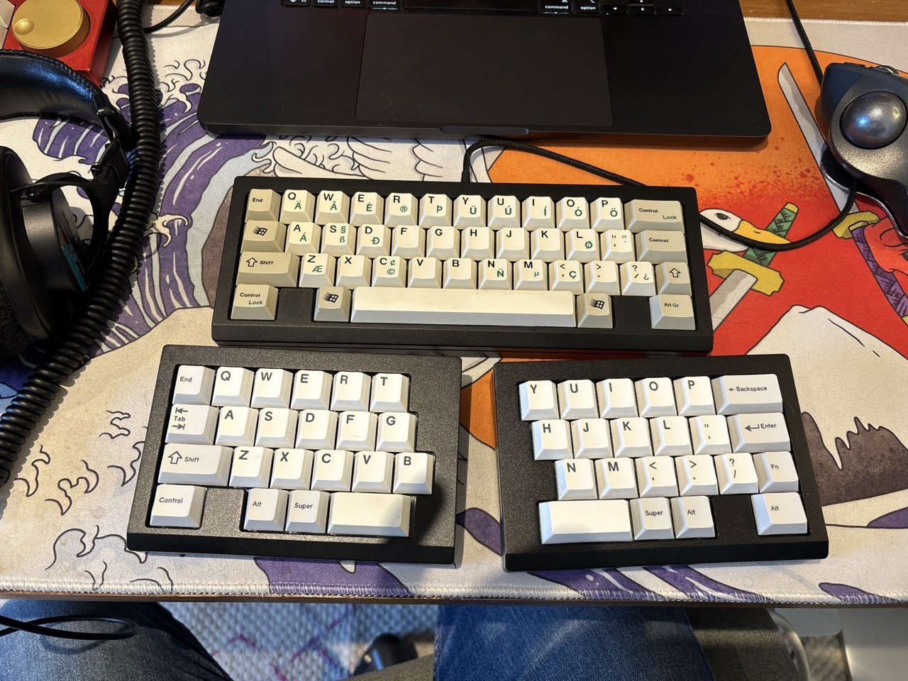
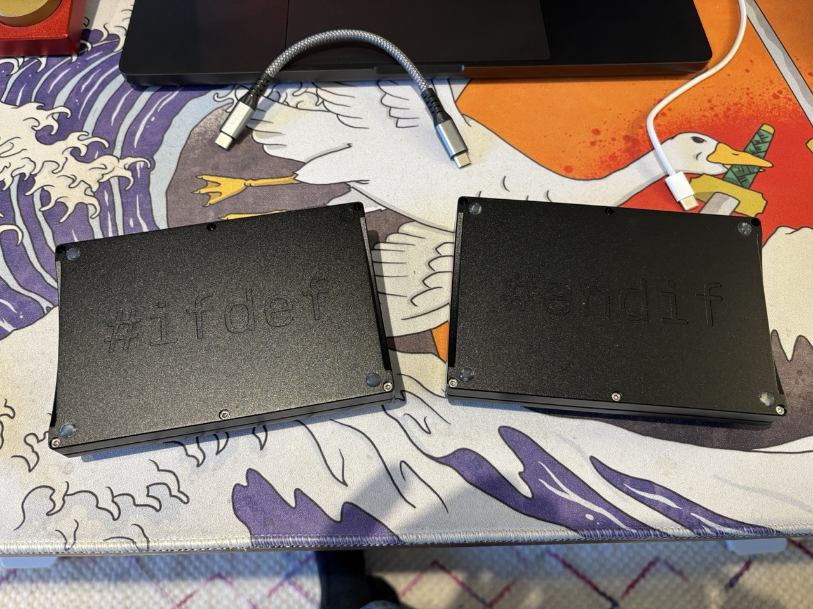
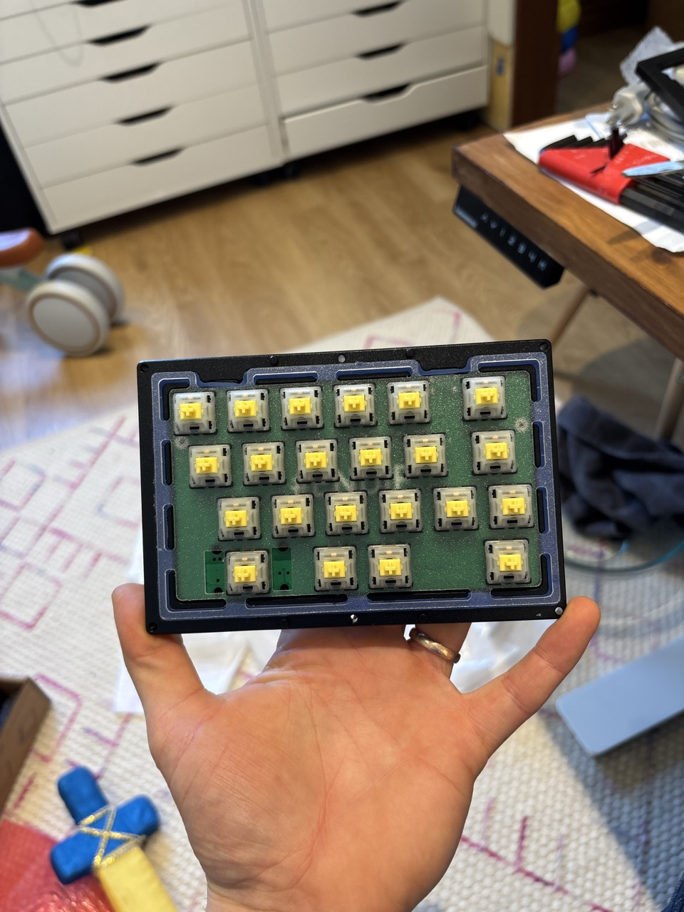
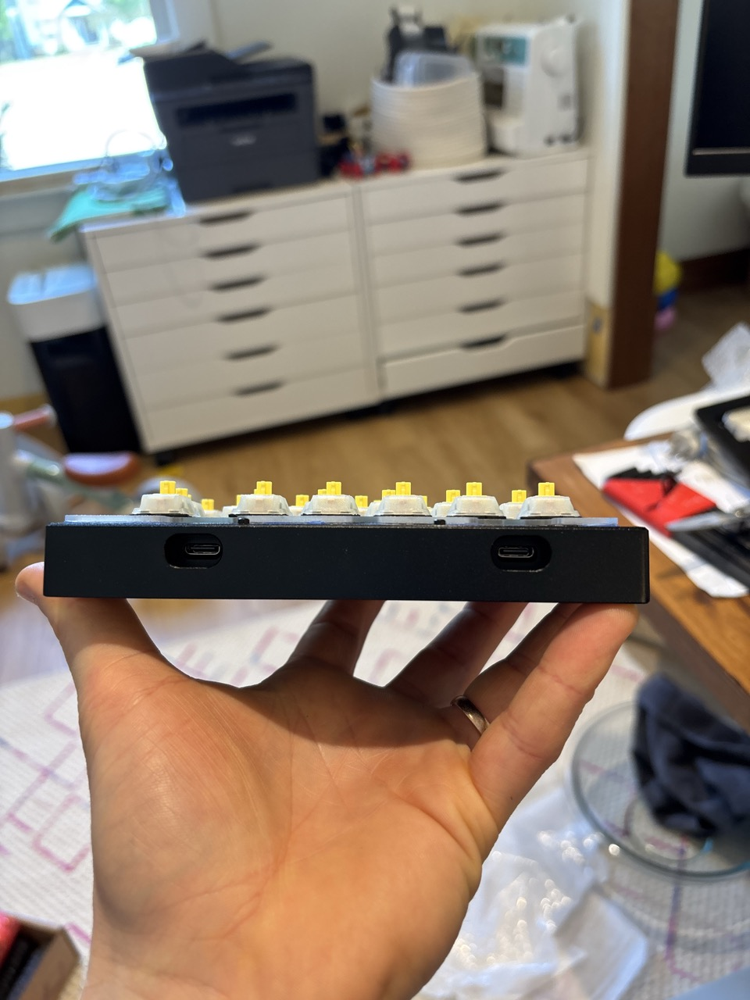
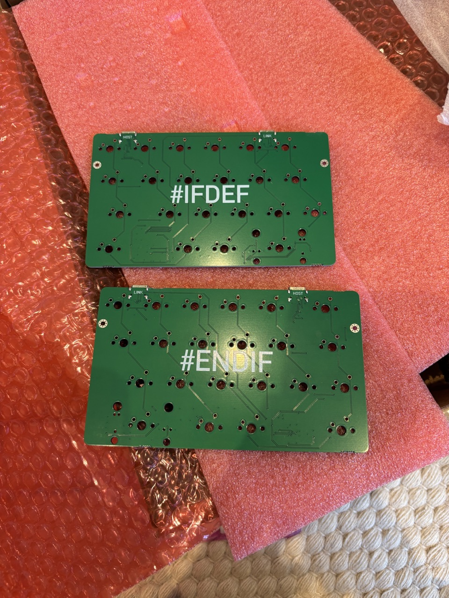
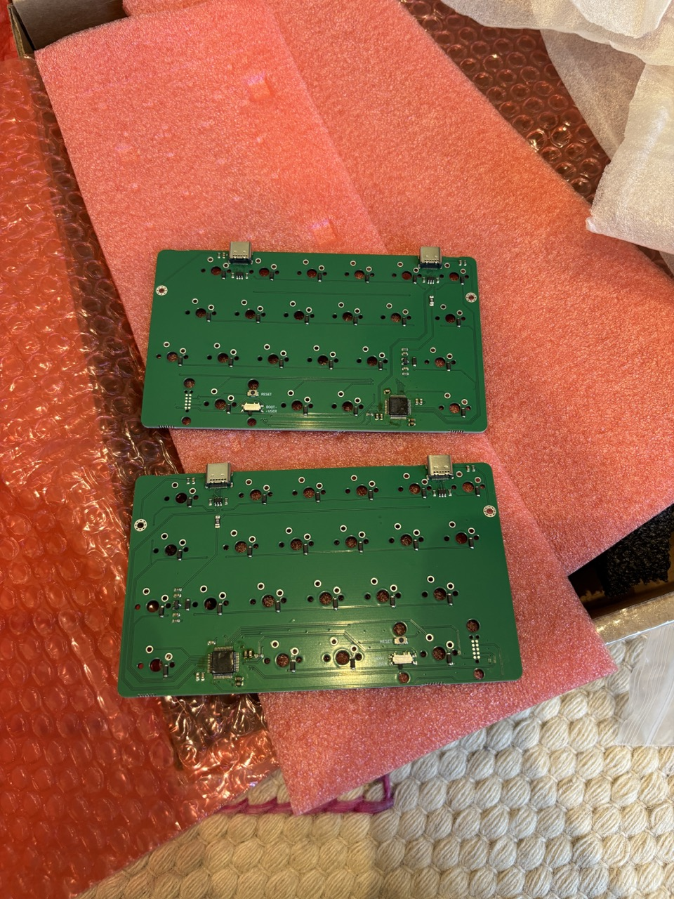
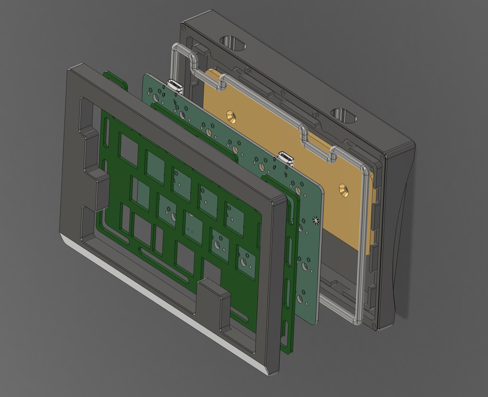

# IFDEF-ENDIF
 IFDEF-ENDIF

IFDEF-ENDIF is a split 40% keyboard designed using a WKL minivan layout (12.75u) that is based on my previous keyboard, [Pragma](https://github.com/dingusxmcgee/Pragma). It uses the same perimeter oring style mount which, depending on the plate, provides a slight bounce and was designed with overall consistency in mind.

It features an accentuated front lip for comfortable typing, a 5 degree angle, and small assembly posts for simple and secure assembly.

This design has been tested through a single 3 unit round of 'prototypes'.

This case and plate were specifically designed around the custom split PCB with onboard USB C. It is included in this repo.

Below is a list of parts you may need:

Bottom-Top screws:
6x sockethead m2.5 10mm
https://www.mcmaster.com/91292A014

6x sockethead m2.5 12mm
https://www.mcmaster.com/91292A016

Daughterboard screws:
4x button/rounded head m2 3mm
https://www.mcmaster.com/92095A276/

O-ring:
AS568-250 or similar is a perfect fit. Slightly smaller or larger may also work. Experiment and have fun.
https://www.theoringstore.com/store/index.php?main_page=product_info&cPath=367_16_18&products_id=878

Many thanks and credit to Rain for making Gumbo, which was used as a basis for Pragma, which this design is based off of.

*All files are provided as is and I accept no liability if they aren't very good.*

*These files were specifically designed to be milled by a CNC machine. Any other fabrication method may require modification*

*Licensed with Unlicense*

If you would like to support me in some way, consider [buying me a coffee :)](https://www.buymeacoffee.com/dingusxmcgee)